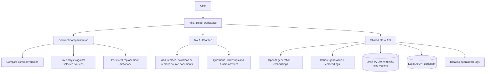
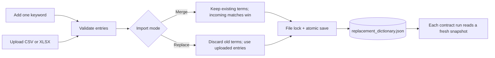
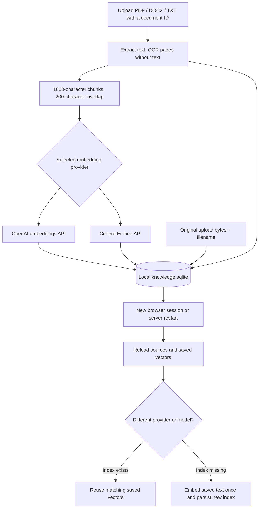
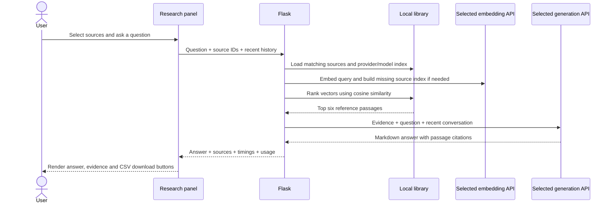
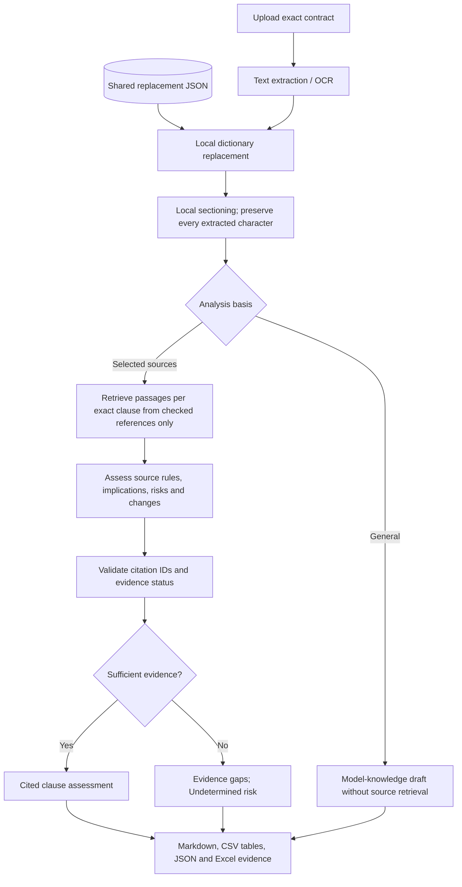
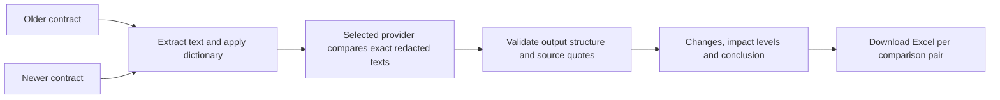
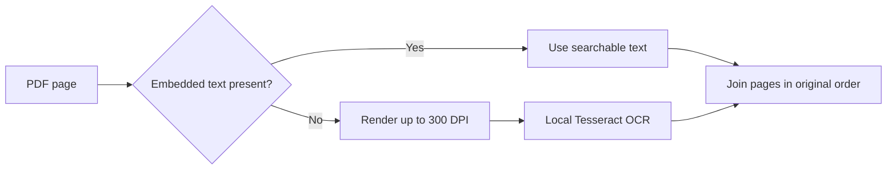
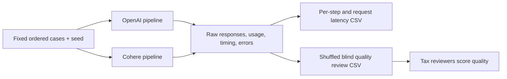

# Zakat & Tax Workspace

A Flask + Vite/React workspace for contract comparison, exact-text contract tax assessment, and source-grounded tax research. Switch between **OpenAI Global API** and **Cohere API**, including each provider’s own embeddings. English and Arabic documents, local OCR, persisted evidence, Markdown answers, and downloadable tables are supported.

> This repository contains application source and documentation only. Uploaded contracts, PDFs, original source files, vectors, local dictionaries, credentials, and generated results remain on your machine and are excluded from Git.

## 1. Workspace at a glance



| Area | What it does |
| --- | --- |
| Compare contracts | Compare selected older/newer pairs, show changed clauses and materiality, download Excel |
| Tax analysis | Apply confidential-term replacements, analyze exact extracted clauses against selected sources, inspect citations and evidence gaps |
| Replacement dictionary | Add individual keywords or import CSV/XLSX; merge or replace; persist across all sessions |
| Tax AI Chat | Search uploaded references, ask follow-ups, request Arabic, inspect evidence, download Markdown tables as CSV |
| Assessment script | Run identical cases against both providers and export per-step latency, usage, raw outputs and blind review sheets |

## 2. Install and run

Use **Python 3.11+** with OpenSSL and **Node 20.19+ or 22**. Python 3.9 bundled with macOS may produce a LibreSSL warning; a current Python installation is recommended.

```sh
git clone https://github.com/abhinavsscbs/ZakatAndTaxWorkspace.git
cd ZakatAndTaxWorkspace
python3 -m venv .venv
source .venv/bin/activate
pip install -r backend/requirements.txt
npm ci --prefix frontend
cp .env.example .env
```

Edit `.env` locally:

```dotenv
OPENAI_API_KEY=your_openai_api_key
COHERE_API_KEY=your_cohere_api_key
DEFAULT_PROVIDER=openai
OPENAI_MODEL=gpt-4.1-mini
OPENAI_EMBEDDING_MODEL=text-embedding-3-small
COHERE_MODEL=command-a-03-2025
COHERE_EMBEDDING_MODEL=embed-v4.0
MAX_OUTPUT_TOKENS=4096
OCR_LANG=eng+ara
```

Only configure the providers you intend to use. The server starts without keys; calls to a missing provider return a clear error. A configured key indicator confirms configuration, not successful authentication or model access. Model IDs are configurable; use models available to your account. Some OpenAI models require default sampling settings, so the app omits temperature for non-GPT-4 defaults unless `OPENAI_TEMPERATURE` is explicitly set.

Start the backend from the repository root:

```sh
source .venv/bin/activate
python backend/app.py
```

In a second terminal:

```sh
npm run dev --prefix frontend
```

Open **http://localhost:5173**. Vite forwards `/api` to **http://127.0.0.1:5000**. The explicit IPv4 address avoids macOS AirPlay intercepting IPv6 `localhost:5000` and returning an empty HTTP 403.

For a built frontend served by Flask:

```sh
npm run build --prefix frontend
PYTHONPATH=backend gunicorn --bind 127.0.0.1:5000 --timeout 600 'app:app'
```

Restart Flask after changing `.env` or backend code. Refresh the page after frontend changes. No account login/logout is implemented; local data is shared by users of the same backend.

## 3. Confidential-term dictionary workflow



1. Open **Contract Comparison → Replacement dictionary**.
2. Add a confidential term and its replacement, for example `Example Company` → `[PARTY_A]`.
3. Click **Add / update**. The entry is saved immediately on the server.
4. To add many terms, upload **UTF-8 CSV** or **Excel `.xlsx`**. Headers must include `Word` and `Replacement` (case-insensitive). Excel reads the first worksheet; `.xls` must first be converted to `.xlsx`.
5. Choose **Add / merge** to preserve the existing dictionary. Uploaded entries overwrite existing case-insensitive matches; the last matching row within an upload wins.
6. Choose **Replace** to replace the whole dictionary. The UI asks for confirmation because the change affects all sessions.
7. Search, delete individual entries, refresh changes from another session, or export CSV/JSON.

Example upload content:

```csv
Word,Replacement
Example Company,[PARTY_A]
Example Account 123,[ACCOUNT_1]
Example Contact,[CONTACT_1]
```

Keep account numbers and other identifiers formatted as **text** in Excel to preserve leading zeros. Blank rows are ignored; incomplete rows, missing/duplicate required headers, formula cells, empty uploads and unsupported formats are rejected before anything is saved. Failed imports leave the current dictionary intact.

**Methodology:** literal, case-insensitive matches; longest terms first; one replacement pass. Replacement values do not trigger additional rules. Only listed terms are masked; this is not automatic confidential-data detection. The shared JSON file is lightweight, readable, locked during updates, and saved atomically. It survives browser closure, session changes and server restarts. Set `DICTIONARY_FILE` to an absolute path to use another location. Protect the file because its keys can contain confidential names.

## 4. Source library and persistence workflow



1. Open **Tax AI Chat**.
2. Choose the AI provider in the header.
3. Enter a unique document ID and tax area, select a source file, and click **Upload & index source**.
4. The server stores the original file bytes, filename, extracted text, tax area, chunks and current provider’s vectors in local SQLite.
5. A source card lists its saved indexes. Click the download arrow to retrieve a retained original file.
6. Switch provider and ask a question. If that provider/model has no saved index, the backend creates it from the saved text and persists it. Otherwise it reuses the existing vectors.
7. Reusing a document ID replaces its original/text and invalidates all old indexes; the selected provider is re-indexed immediately. Removing a source deletes its text, original and all associated vectors.

**Persistence details:** `data/knowledge.sqlite` is a real local file, independent of browser storage or Flask sessions. The default is anchored to the project directory, including when launching Flask from another working directory. `DATA_DIR` can point to an absolute persistent volume; relative paths are resolved from the project root. OpenAI and Cohere vectors are isolated by **document ID + provider + embedding model** and never mixed. Both APIs are used directly; there is no local sentence-transformer fallback.

Older databases are migrated to add original-file storage without deleting existing text/vectors. If an entry predates original-file retention, re-upload the original document to enable original download. Its already-stored text and embeddings remain searchable.

Local persistence survives application restarts, not deletion of the disk or an ephemeral container volume. Back up the SQLite file and dictionary with the application stopped, or use SQLite’s backup API. Mount `DATA_DIR` and the dictionary path on durable storage when deploying. Existing legacy FAISS/pickle indexes cannot be used with the new embedding spaces; re-upload their source documents.

## 5. Source-grounded research workflow



1. Check source documents to limit the search; leaving all unchecked searches the library.
2. Ask a question. Recent conversation is sent with follow-ups (up to four messages; each message is bounded).
3. Select **Answer in Arabic** when desired.
4. Read compact Markdown headings, lists, tables and citations. The conversation scrolls inside its panel; the question box stays visible.
5. Expand **retrieved passages** to inspect the actual source text. Similarity is a ranking signal, not answer confidence or proof of legal applicability.
6. Click **Download CSV** on any answer table. Downloads preserve UTF-8/Arabic, quotes and multiline cells, and neutralize formula-like cell values for spreadsheets.

**Methodology:** retrieval-augmented generation (RAG). The selected provider embeds the query; NumPy cosine similarity ranks stored chunks; the top six passages are included in the generation prompt. The model is instructed to use those sources, cite `[document:chunk]`, treat documents as data, and acknowledge insufficient evidence. The app does not verify that uploaded laws are current. Chat conversation history is browser component state and is not persisted like the library.

## 6. Exact-contract tax analysis workflow



1. Set up confidential-term replacements first.
2. Upload relevant regulations or other references in **Tax AI Chat**.
3. Open **Contract Comparison → Tax analysis** and upload the contract.
4. Keep **Selected sources of truth** enabled. Refresh the library, filter by document ID or tax area, and check relevant sources. Filtering does not remove already checked sources.
5. Click **Analyze against selected sources**.
6. The backend applies dictionary replacements locally **before contract text enters generation or embedding requests**. It sections the exact resulting text locally; it does not summarize the contract or ask the model to rewrite/extract clauses.
7. Each section is assessed against retrieved passages from only the checked sources. Review source rules, implications, recommendations, evidence gaps, risk and the exact redacted clause text.
8. Inspect reference passages and distinguish cited evidence from additional retrieved context. Unsupported citation IDs are rejected. Insufficient evidence produces **Undetermined** risk.
9. Export JSON or Excel. Excel contains `Run_Details`, `Contract_Text`, `Detailed_Analysis`, `Risk_Assessment`, `Source_Evidence` and `Source_Selection` sheets.

**Methodology:** deterministic sectioning preserves the full extracted text in order, with headings/line boundaries where available and a 3,000-character section cap. The first bounded portion of each section forms the retrieval query; the entire section is included in its tax-assessment prompt. No maximum-clause count silently discards later sections. Exact text means extracted/OCR text after dictionary replacements, not the document’s page layout. OCR may introduce recognition errors.

**General analysis** is an explicit alternative that uses model knowledge without reference retrieval. Its risk is estimated from response wording. Source-grounded mode uses structured risk/evidence fields and citation checks; those checks establish citation identity, not factual entailment or legal correctness. Source authority, jurisdiction and effective date still need review.

## 7. Contract version comparison workflow



1. Open **Contract Comparison → Compare contracts**.
2. Upload at least two contracts and choose older/newer versions for each pair.
3. Add more pairs to compare batches, including reuse of an uploaded file.
4. Run the comparisons. The shared replacement engine masks configured terms locally.
5. Read changes, exact quoted snippets and impact levels: Not At All, Slight, Moderate, Significant, Extreme.
6. Download the Excel report for each successful pair. Failed pairs report their own errors.

This feature compares contract changes; it does not automatically apply tax reference sources. Use **Tax analysis** to assess a contract’s clauses against selected legislation. Client-chosen server export paths and arbitrary folder scanning are not supported.

## 8. OCR workflow



Tesseract must be installed separately. On macOS with Homebrew:

```sh
brew install tesseract tesseract-lang
which tesseract
tesseract --list-langs
```

Example `.env` configuration:

```dotenv
TESSERACT_CMD=/opt/homebrew/bin/tesseract
OCR_LANG=eng+ara
OCR_TIMEOUT_SECONDS=60
MAX_PDF_PAGES=100
```

Omit `TESSERACT_CMD` when the executable is already on PATH. Ensure the requested language packs are installed. Mixed scanned/searchable PDFs are handled page by page. Oversized page images use reduced resolution to cap raster size; missing binaries, language failures and timeouts return useful errors. DOCX preserves paragraph/table reading order and internal text spacing. Legacy `.doc` requires conversion to `.docx`.

## 9. Observability and timing

| Information | Where to see it |
| --- | --- |
| Live request elapsed time | Execution Trace status pill |
| Completed processing steps | Frontend execution table |
| API tokens, model, retries | Execution details and raw telemetry |
| Detailed operational history | `logs/app.jsonl`, rotating at 10 MB with five backups |
| Request correlation | `X-Request-ID`, JSON telemetry and log records |
| HTTP server duration | `Server-Timing` response header |

All frontend elapsed times are rounded to the nearest minute; less than 30 seconds displays **0 min**. Logs and assessment reports retain millisecond precision. Completed step durations arrive with the final response; intermediate server events are not streamed. Logs avoid document bodies, dictionary entries, questions, answers and API credentials. Assessment reports intentionally include answers/evidence, so keep them private.

## 10. Compare OpenAI and Cohere

```sh
source .venv/bin/activate
python scripts/assess.py --cases scripts/cases.example.json --repeats 5
```

The example suite generates **synthetic** text fixtures locally on first use; source documents are not distributed. These examples are not real tax law. Both real API keys are needed for a successful two-provider comparison, and requests incur API usage.



| Output | Meaning |
| --- | --- |
| `raw.json` | Full outputs, models, seed, case hash, telemetry and quality heuristics |
| `summary.csv` | Success/error counts and request mean/p50/p95 by provider/case |
| `steps.csv` | Per-call processing-step mean/p50/p95 |
| `usage.csv` | Model usage, HTTP status, attempts, output cap, finish reason and returned rate-limit headers |
| `blind_review.csv` | Shuffled responses; reviewer columns for correctness, grounding, completeness, clarity and notes |
| `review_key.csv` | Provider identities; keep hidden until scoring finishes |

Results use a timestamped directory under `assessment-results/` and an isolated benchmark database/dictionary. Provider order is seeded and varied; case order stays fixed so upload cases precede dependent questions. Repeated uploads intentionally invalidate indexes: inspect `document_embedding` calls to separate cold/warm latency. Small-sample p95 is not an SLA. Step timings are per call, not summed request percentiles.

Add your own case file with representative bilingual sources and gold answers. Tasks: `upload`, `chat`, `comparison`, `tax`. Grounded tax cases set `analysis_mode` to `grounded` and `selected_doc_ids` to IDs uploaded by earlier cases. Keyword coverage and citation syntax are diagnostic proxies, not factual correctness scores. Have qualified reviewers score the blind sheet from 1 to 5, then join the provider key on `blind_id`.

The script uses Flask’s test client with real outbound API requests: it measures processing but excludes browser transport and deployed worker queuing. Use a separate concurrency/load test before promising production throughput. Tokenizers, billed units and embedding spaces differ across providers; compare actual cost per successful task, not raw token counts alone. The script exits nonzero if any case fails.

See [the sourced production assessment](docs/PRODUCTION_ASSESSMENT.md) for model context/output limits, rate limits, prices, methodology and deployment constraints.

## 11. Current limits and deployment boundaries

| Limit | Default |
| --- | --- |
| Request upload size | 25 MB |
| Comparison contract size | 22,000 characters per version after replacements |
| Tax contract size | 16,000 extracted characters before replacements |
| Tax section size | Up to 3,000 characters; no summary substitution |
| Research question size | 8,000 characters |
| Retrieval chunk size / overlap | 1,600 / 200 characters |
| Embedding batch size | 64 inputs |
| Retrieved passages | Up to 6 per query/section |
| Generation output cap | 4,096 tokens, configurable |
| PDF size | 100 pages, configurable |
| OCR timeout | 60 seconds per scanned page, configurable |

These are application limits, not the providers’ maximum context windows. Long contracts are rejected instead of silently truncated. The output cap includes the selected model’s completion budget; hitting the limit returns an explicit error. Requests retry 429/transient 5xx up to three attempts with capped backoff. Operational errors include provider details without printing credentials.

This is a **local shared-workspace application**, not a public multi-tenant service. It currently has no authentication or tenant isolation. Before public deployment, add identity/access control, request/job limits, durable encrypted storage, retention policies, cancellation, background jobs and tested concurrency. SQLite/NumPy retrieval is appropriate for a modest local corpus; use revision-safe indexing and a vector database for larger concurrent workloads. Concurrent document replacement and lazy indexing can race; file-locked dictionary updates do not solve index revision races. Global API processing is not a regional data-residency guarantee.

## 12. Repository layout and private artifacts

```text
backend/                 Flask API, provider adapters, SQLite library, services
frontend/                Vite + React UI and lockfile
scripts/                 Assessment, local synthetic fixture generation, publication check
tests/                   Mock API, OCR, persistence, source isolation and import tests
docs/                    Sourced provider and production assessment
.github/workflows/       CI validation
.env.example             Empty credential/configuration template

Created locally and excluded from Git:
.env                     Real API credentials
data/knowledge.sqlite    Original files, extracted text and both providers’ vectors
replacement_dictionary.json  Shared confidential-term mappings
logs/                    Operational JSONL logs
output/                  Generated comparison Excel files
assessment-results/      Benchmark outputs and isolated local data
scripts/fixtures/        Locally generated synthetic TXT inputs
```

No PDFs, Word/Excel/CSV documents, SQLite files, dictionary contents, legacy project data or generated artifacts should be committed. `.gitignore` and `scripts/check_publication.py` enforce a source-only publication boundary. Custom external storage locations must also stay outside Git. A code scan is a safeguard, not a substitute for reviewing staged changes.

## 13. Tests and checks

```sh
.venv/bin/python -m pytest -q
node --test frontend/src/components/csv.test.js
npm run build --prefix frontend
npm audit --prefix frontend
.venv/bin/python scripts/check_publication.py
```

Tests use mocked provider calls. They cover API payloads, provider isolation, retries, output-limit errors, exact contract preservation, pre-request redaction, concurrent dictionary updates, CSV/XLSX merge/replace atomicity, invalid citations, evidence exports, mixed-PDF OCR and library reuse from a **fresh Python process** without re-embedding documents. API-backed quality, account permissions, latency and throughput require separate live assessment runs. CI repeats the tests and build without real keys.

## 14. Troubleshooting

| Symptom | Check |
| --- | --- |
| Empty JSON / HTTP 403 in browser | Vite proxy should use `127.0.0.1:5000`; avoid macOS AirPlay on IPv6 localhost |
| Generation/embedding says unavailable | Start Flask; check `/api/providers`; click retry connection |
| HTTP 400 from OpenAI | Read specific provider error; verify selected model, parameters and output cap |
| HTTP 429 | Check account quota/rate limits; reduce request volume; inspect retries and usage |
| Scanned PDF cannot be read | Check Tesseract executable and language packs; increase timeout or split PDF |
| Sources disappear after deployment restart | Mount durable `DATA_DIR`; verify the server uses the same path/volume |
| Original source download unavailable | Older entries retain text/vectors only; re-upload once to retain original bytes |
| Dictionary import rejected | Use `Word` / `Replacement` headers, nonblank literal values, UTF-8 CSV or first-sheet XLSX |
| New source not listed in tax analysis | Refresh sources; select the intended IDs explicitly |
| New dictionary entry not visible | Refresh shared dictionary; each new analysis already reads the latest disk version |
